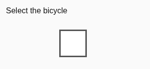
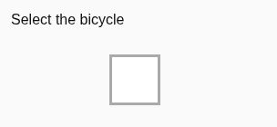

# af229cc real-provider cosmetic-hover comparison — Sol

**FAIL for cosmetic acceptance.** On exact router `af229cc363c6a602f2964bfda2c4961dd0cf6e5f`, the preserved actual v2 border-hover pair and the independent empty-control border-color pair both returned false. All seven noncosmetic corpus changes were refused; the unchanged pair returned true without inference. This is isolated comparison coverage, **not native CAPTCHA, skill, private-egress, production-provider challenge, or release acceptance**. Prior [857 native results](browser-native-live-sol-857074d-2026-10-20.md) remain immutable.

Run: 2026-10-20 UTC; Node `v24.14.1`; headed `Chrome/155.0.8059.84`, Xvfb, 1024×768 CSS/device pixels. Exact detached router checkout; Spot branch `conductor/spot-skill-outcomes-qa`. Owned report/artifacts only. No product edits, new unit tests, native input, customer/mail/backend/env actions, previews or deployment.

## Source and fixed protocol

The actual diff from `857074d99baa09792b66a45d65a3ca73aef53719` changes only `AGENT_TOOLS.md` and `packages/server/src/browse/primitives.ts`. Each of the same six questions now has its relevant before/after asset references inside structured `instructions`. Shared state has no image references. Picture scope and mark equality wording changed; `.9` all-required threshold, transformations, deterministic containment and native guards did not change. No source/model/question/threshold variants were tried.

[Source binding](artifacts/website-tech-skill-outcomes-2026-10-20/comparison-af229cc-sol/source-binding.json) records full source SHA256 `005e60212307cc2d5192d46dab4b63e73cc25db6ee1d97b8c6e26fb34fee7a50` and verbatim closure SHA256 `0087d228841341f7de71e172c4d1424492a111c55124d0416dee995b86a276eb`. [Extracted closure/helper/constants](artifacts/website-tech-skill-outcomes-2026-10-20/comparison-af229cc-sol/source-closure.ts) were bound to the actual candidate `executeDecision`; the wrapper only retains/validates inputs and limits HTTP sends. No scripted answers or provider bridge. Existing authorized direct TypeSafe configuration was used without exposing credentials. Actual wire model `jev-latest`; all eight responses report `jev-1.13.0`, HTTP 200, via candidate default `https://api.typesafe.ai/v1/systemone`.

The [plan](artifacts/website-tech-skill-outcomes-2026-10-20/comparison-af229cc-sol/corpus-plan.json) and [fixture](artifacts/website-tech-skill-outcomes-2026-10-20/comparison-af229cc-sol/fixture.html) were fixed before any inference (declaration `21:15:09.467Z`). All nine corpus DOM observations and actual browser captures were frozen before corpus inference (`21:19:15.033Z`, trace seq26). Case IDs, expected outcomes and DOM truth were never supplied to the model. They determine the independent expected result, not model answers. Each pair invoked the actual closure once. Eight logical requests/eight HTTP sends, zero retries, zero variants; two deterministic paths made no model request. No preserved-case rerun after its failure.

## Results

Scores below preserve order: `same_instruction / same_images / same_selection / same_control / no_new_mark / style_only`. Every value must be at least `.90`. `elapsed/provider ms` means local whole closure plus validation, then provider-reported duration; it is not native interaction latency. Full responses retain usage/cost/duration and request identifiers.

| Pair | Expected → actual | Six actual scores | Path/result | Elapsed/provider ms |
| --- | --- | --- | --- | --- |
| Preserved actual 857 v2 | true → **false** | .98 / .97 / .98 / **.85** / .90 / **.87** | Semantic false negative | 872 / 301 |
| Unchanged | true → true | — | Unchanged fast path | 6 / — |
| Border-color hover only | true → **false** | .97 / .97 / **.80** / .92 / .93 / .96 | Semantic false negative | 967 / 289 |
| Added tick | false → false | .98 / .95 / .04 / .95 / .01 / .03 | Semantic true negative | 930 / 273 |
| Removed existing mark | false → false | .97 / .91 / .02 / .90 / .01 / .03 | Semantic true negative | 967 / 246 |
| New spinner/symbol | false → false | .98 / .85 / .68 / .91 / .02 / .08 | Semantic true negative | 902 / 271 |
| Replaced picture | false → false | .98 / .02 / .89 / .92 / .02 / .01 | Semantic true negative | 803 / 247 |
| Changed instruction | false → false | — | Deterministic containment refusal | 2 / — |
| Moved/resized control | false → false | .98 / .98 / .98 / .58 / .91 / .53 | Semantic true negative | 880 / 314 |
| Changed selected state | false → false | .96 / .94 / .02 / .88 / .03 / .02 | Semantic true negative | 899 / 286 |

Zero semantic false positives in these six semantic negative cases; the seventh negative was rejected before inference. Neither positive semantic pair passed. No provider/schema/transport failure or input-validation failure occurred in an attempted comparison. These bounded observations do not estimate general accuracy or establish a paired causal effect against prior source.

**Actionable reproduction:** the controlled border-only case has the same empty unchecked control, instruction, size and position, and only changes border `#555` to `#aaa`. Actual DOM observations agree; 636 changed pixels lie exclusively on the border. The comparison refuses because `same_selection=.80`, despite `.92/.93/.96` on control/marks/style. The preserved pair separately refuses on `same_control=.85` and `style_only=.87`. Preserve these exact inputs and answers for manager diagnosis; low scores alone do not establish their cause. No tuning/repeat was performed.

Actual browser-rendered border-only inputs (visually reviewed):




## Geometry and exact image evidence

All coordinates below use top-page pixels for `visible`/`located`, frame-local pixels for changed bounds/regions, and canvas pixels for model images. Changed bounds are inclusive; region right/bottom are exclusive. [Results](artifacts/website-tech-skill-outcomes-2026-10-20/comparison-af229cc-sol/results.json) contain every rectangle, changed-pixel count/bounds, decoded RGBA hash and exact PNG hash. [Frozen ground truth](artifacts/website-tech-skill-outcomes-2026-10-20/comparison-af229cc-sol/corpus-ground-truth.json) contains all before/after DOM observations. Every browser viewport PNG and its lossless frame crop is retained.

Preserved case provenance was required and present before inference: original actual refined Box `{top:.09,bottom:.20,left:.04,right:.12}`, confidence `.94`, refinement scale3, source image hash `cad19b993a2289d7594fd2a2a72fdb6bbb816b49df557e47b8ea1a71f4699298`. The original private request005 image and response matched the durable prior provenance. Mapping `viewportX=283+boxX*1024/3`, `viewportY=332+boxY*768/3` yields exact located Rect `(296.6533333333333,355.04,27.306666666666672,28.159999999999968)`. Visible frame `(283,332,304,78)`; +4 clipped region `[9,45)×[19,56)` =36×37; nearest-neighbor scale8 gives288×296 at canvas origin. Delta300 pixels at inclusive `(13,23)..(40,50)` is contained. The four new source canvases were **byte-identical** to the four prior `3965f4ec` hover PNGs before the single inference. [Preserved provenance](artifacts/website-tech-skill-outcomes-2026-10-20/comparison-af229cc-sol/preserved-provenance.json) binds the original frames and full capture hashes. The already-present quota warning and limitations remain as recorded in the prior857 packet; no new live demo interaction occurred.

Every corpus frame is `(283,300,304,140)`; supplied actual before-DOM target is `(403,360,56,56)`. Source region `[116,180)×[56,120)` =64×64; scale8 yields512×512 at origin. The moved/resized after-control is `(404,361,58,58)`; the original before Rect remains the supplied target and its delta is still inside +4. Instruction change is outside this region and makes no inference. Unchanged delta is zero.

All four transport images are opaque1024×768 `#808080` canvases. Images0/1 embed the unchanged frame pixels at the original viewport position, unscaled. Images2/3 embed the exact same target region, integer nearest-neighbor scale8 at origin. Every decoded output pixel, including all gray padding, was validated against source pixels before inference; no image editing substitutes for corpus browser captures. The offline verifier repeats these comparisons and checks viewport→crop linkage.

Questions1–3 each reference only images0/1; questions4–6 each reference only images2/3. Four opaque asset IDs are distinct; before/after refs within each question are distinct. An unchanged subregion can legitimately have identical pixel content. Actual canonical wire state/questions/image bytes equal actual logical input. All four PNGs are supplied once in the request asset table; no image refs/assets appear in shared state and no unrelated pair appears in an individual question's instructions. This proves the candidate/API-boundary representation; provider-internal prompt/image expansion is not observable here.

## Setup failure and scope

The original controller completed the preserved comparison, then failed fixture readiness before any corpus capture or inference. Its normal sandbox `BrowserTargets` lane refused `http://127.0.0.1:<ephemeral>/fixture`: `targets.ts` `Fetch.requestPaused` permits only `publicRetrievalUrl`, otherwise `Fetch.failRequest`/`BlockedByClient`. This is an expected private-egress guard, not a comparison model error. The initial controller records only readiness failure; the source supplies the guard diagnosis. [Setup record](artifacts/website-tech-skill-outcomes-2026-10-20/comparison-af229cc-sol/setup-failure.json).

Manager explicitly authorized ordinary local Chrome solely to render the predefined controlled fixture. The continuation used raw top-target CDP `Page.navigate`, controlled DOM state changes, `getBoundingClientRect` and `Page.captureScreenshot`, without `BrowserTargets`. No product guard was disabled/altered. DOM supplies synthetic fixture truth and geometry only; this is neither Box localization proof nor native user interaction. It does not validate BrowserTargets/private-egress acceptance, remote-host retrieval or live challenge behavior. There were zero `Input.*` commands and no click/press/release. The fixture is deliberately controlled rendered markup, not Spot UI or an invented CAPTCHA acceptance screenshot.

## Durable requests, redaction and reproduction

[Full sanitized logical and canonical wire requests, all answers](artifacts/website-tech-skill-outcomes-2026-10-20/comparison-af229cc-sol/logical-wire-requests-sanitized.json), [redaction ledger](artifacts/website-tech-skill-outcomes-2026-10-20/comparison-af229cc-sol/redaction-ledger.json), [protocol/model trace](artifacts/website-tech-skill-outcomes-2026-10-20/comparison-af229cc-sol/protocol-model-trace.json), [publication checks](artifacts/website-tech-skill-outcomes-2026-10-20/comparison-af229cc-sol/publication-checks.json) and [manifest](artifacts/website-tech-skill-outcomes-2026-10-20/comparison-af229cc-sol/manifest.json) preserve the evidence. Actual complete logical input was written privately0600 **before inference**. The provider received that unchanged input, never its sanitized copy. Raw PNG base64 is replaced by a reference to exact durable PNG bytes; opaque asset keys/references normalize consistently. Ledger records JSONPointer placement (after asset-key normalization), original string UTF16 spans/hashes and replacements. No other logical/wire content changed. Credentials/headers/cookies were never stored in these artifacts. Public trace has no raw PNG/base64.

Executed source/setup commands, all on the detached candidate:

```sh
git fetch origin manager/browser-runtime-candidate
git checkout --detach af229cc363c6a602f2964bfda2c4961dd0cf6e5f
npm ci --ignore-scripts --no-audit --no-fund
npm run build --workspace @claritylabs/cl-router-policy
```

Dependency install and policy-only build passed. Manager's full `npm run check` PASS is reported by manager, not independently rerun here. Scripts passed syntax checks; offline hash/pixel/request checks and `git diff --check` passed. No broad build or new unit test was added/run.

Historical controllers are [evaluate.mjs](artifacts/website-tech-skill-outcomes-2026-10-20/comparison-af229cc-sol/evaluate.mjs) (preserved case + refused original fixture setup) and [corpus-only.mjs](artifacts/website-tech-skill-outcomes-2026-10-20/comparison-af229cc-sol/corpus-only.mjs) (only unattempted cases, ordinary rendering). They require Node24, candidate dependencies/policy build, Xvfb `:99`, existing authorized provider config, `QA_ROUTER_CHECKOUT`, private0700 `QA_PRIVATE_OUTPUT`, and prior evidence paths `QA_PRIOR_ARTIFACTS`/`QA_PRIOR_PRIVATE`. The initial provenance check additionally used the retained original857 private request005 and response trace to bind Box/image/Rect, not credentials or a new model call. Public preserved provenance, prior durable frames and the new exact canvases retain the resulting mapping; those old private files are not a portable public dependency for offline review. Do not rerun provider controllers under this terminal packet. Their guards refuse an existing declaration or already-appended corpus, preventing accidental repeats. A later authorized replay would need a new private output and bounded dispatch.

Safe offline review (no provider/browser calls; use an exact candidate checkout with installed dependencies):

```sh
QA_ROUTER_CHECKOUT=/path/to/cl-router-at-af229cc node \
  docs/testing/artifacts/website-tech-skill-outcomes-2026-10-20/comparison-af229cc-sol/verify-artifacts.mjs
```

[publish.mjs](artifacts/website-tech-skill-outcomes-2026-10-20/comparison-af229cc-sol/publish.mjs) is offline-only packaging from the private run store; it preserves the original preserved result/trace prefix and verifies request timing/mode, reference placement, actual wire equality and counts. SHA256 manifest covers the durable artifact set. Browser screenshots were visually reviewed, including both cosmetic pairs, tick removal/addition, spinner, picture replacement, instruction change, movement and selected state.

[Cleanup receipt](artifacts/website-tech-skill-outcomes-2026-10-20/comparison-af229cc-sol/cleanup.json): Chrome CDP9222 closed; fixture server stopped; owned Xvfb stopped; both temporary profiles removed. Prior private inbox adapter and pending exact-From question untouched. No source switches, browser/model diagnostics or further interactions after terminal results. Manager owns correction decisions. STOP.
