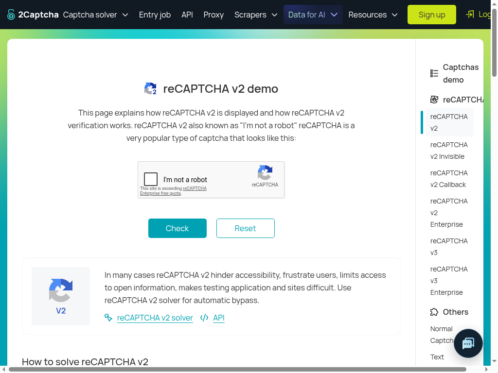
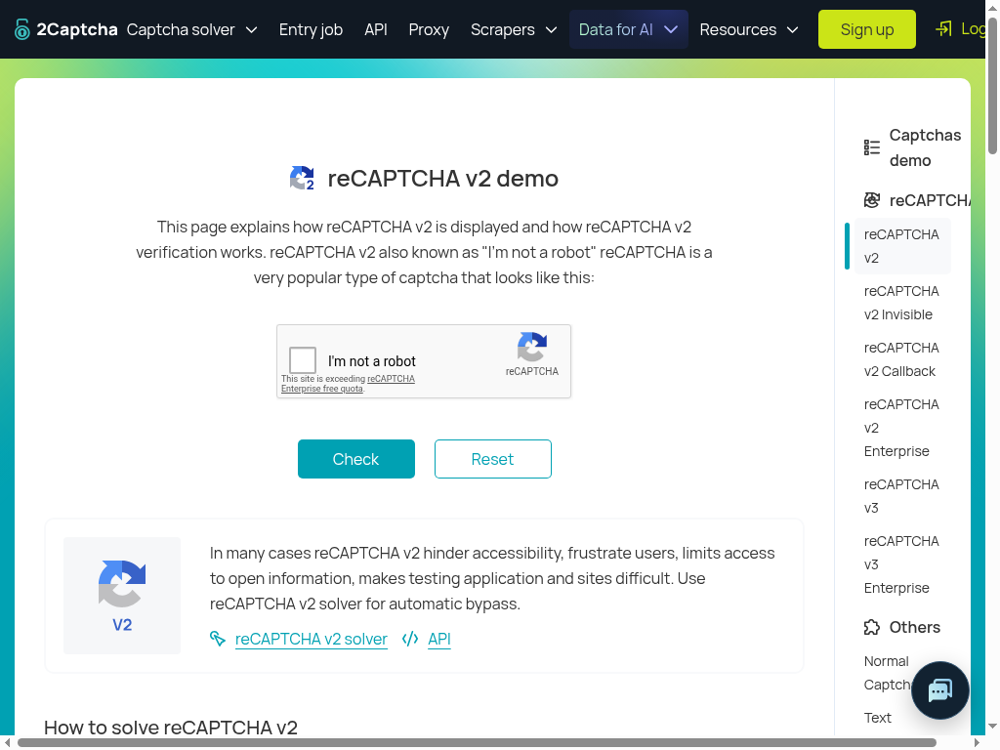
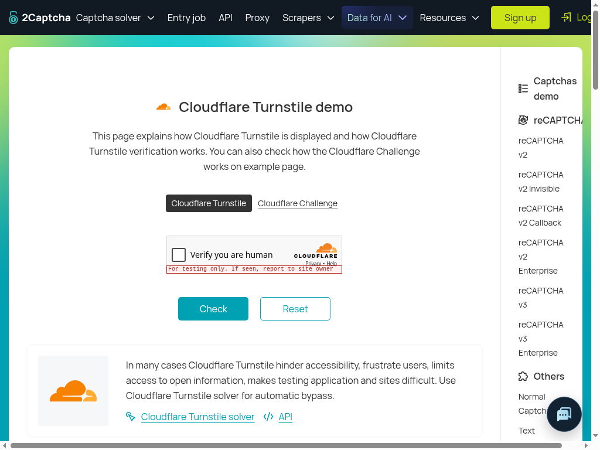
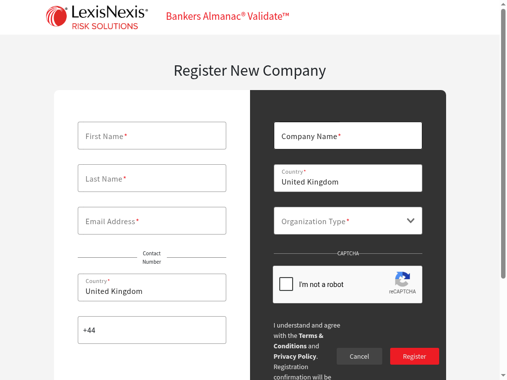
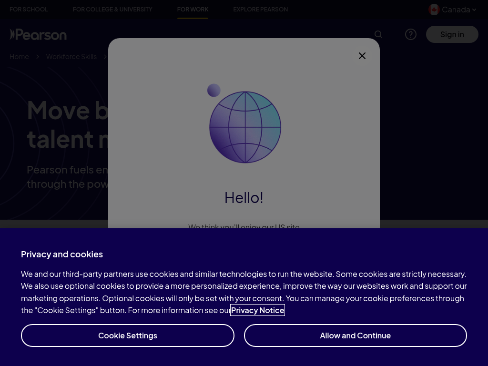
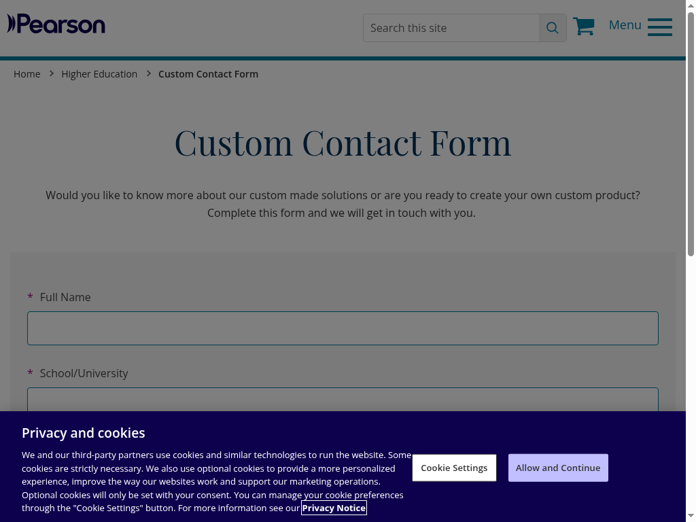

# Native browser live QA — Sol, October 20, 2026

**FAIL for functional acceptance on router `ca0b36a7871454929bfc2b64d5b9589d3e866cd5`.**
The candidate reached real Jev and moved the real top-page cursor, but neither
CAPTCHA was solved. Customer registration/contact writes were blocked by inbox
access and existing runtime capability boundaries. No customer fields were filled
or submitted. This baseline does not accept a release or any later correction.

[Sanitized results](artifacts/website-tech-skill-outcomes-2026-10-20/live-ca0b36-sol/results.json),
[protocol/decision trace](artifacts/website-tech-skill-outcomes-2026-10-20/live-ca0b36-sol/runtime-trace.json),
and [artifact hashes](artifacts/website-tech-skill-outcomes-2026-10-20/live-ca0b36-sol/manifest.json).

## Exact setup and scope

- Router fetched from `claritylabs-inc/cl-router`, detached at the exact candidate
  on `origin/manager/browser-runtime-candidate`; source remained clean. Spot stayed
  on `conductor/spot-skill-outcomes-qa`, starting at report commit `85897327`.
- Node **24.14.1**, headed **Chrome 155.0.8059.84**, Xvfb `:99`, fixed
  **1024×768** CSS viewport. Native `CdpConnection`, `BrowserTargets` with
  `sandbox:true`, `createBrowserRuntime` with `isSandbox:true`, `skillBrowser`,
  `createSkillHarness`, `challenge.captcha`, and the production action gate.
  This exercised sandbox mode on cloud Chrome, not the hosted microVM provisioner,
  deployed job runner or autonomous generation actor.
- Existing process `TYPESAFE_API_KEY` was present. Actual unmodified
  `executeDecision` called `https://api.typesafe.ai/v1/systemone` directly:
  `jev-latest` returned **jev-1.13.0** for Nouls; Box used **jev-1.14.0**.
  No bridge, scripted answers, answer transformation or provider-key extraction.
  The initial live text probe returned blue=0.81. Real image requests and responses
  are linked by screenshot SHA-256 in the trace; image bytes were not logged.
- No Playwright client was running or attached. Only the candidate CDP client
  attached/resumed targets. Its real screenshot-based Box localized the target;
  protocol frame geometry served the candidate's guard, not an alternate DOM target
  oracle. No DOM click, child-session input, challenge-state edit, response-token
  injection, solver API, extension, account login or payment was used.
- Jev Box received the full viewport. Candidate frame crops supplied pixel
  consistency checks; this is not evidence of a separate model-local-crop path.

## Scenarios and observed outcomes

| Scenario | Actual result | Verdict / limit |
| --- | --- | --- |
| [2Captcha reCAPTCHA v2](https://2captcha.com/demo/recaptcha-v2), skill | Visible unticked widget; `present=0.49`, `checkbox=0.97`. Skill returned `blocked / ambiguous_challenge`, zero attempts. | FAIL functional path. The atomic presence question requires an unsolved challenge that “blocks the page”; the demo remains readable. Thresholds stayed unchanged. |
| v2 native primitive, separately gated | After observing the page, gate relevance=0.73. Real Box confidence=0.91. Sixteen top-session mouse moves ran, then the candidate refused: “The challenge changed while it was being located or hovered. Observe again.” | FAIL functional path, safe refusal. Zero mouse press/release. No grid, verification, replacement or completion observed. |
| [2Captcha Turnstile](https://2captcha.com/demo/cloudflare-turnstile), skill | Visible testing-only unticked widget; `present=0.64`, `checkbox=0.97`, `turnstile=0.96`. Same ambiguous-challenge blocker, zero attempts. | FAIL functional path. No visible Success or host Check validation. |
| Turnstile separate primitive request | Action gate relevance=0.59; refused before native primitive execution. | BLOCKED. No Box/motion/frame-owner acceptance for Turnstile on this candidate. Earlier ordinary-browser test-key success in `85897327` is not carried as native acceptance. |
| [Bankers Almanac registration](https://beta.validate.bankersalmanac.com/ba-mgmt/registration/new-user) | Actual “Register New Company” page, first/last name, email, contact number/country, company/country, Organization Type, reCAPTCHA and terms text. Candidate snapshot reports no password field. | BLOCKED before filling/submission. Inbox access was not established, and current signup submission requires the fixed password to be present. Required non-identity fields also exceed account skill fill planning. |
| [Pearson Canada](https://www.pearson.com/en-ca/work/forms/contact-us.html) | Candidate snapshot observed goals textarea, name, business email, phone, organization, job, profession, country, marketing and consent controls. Actual page screenshot has cookie and country overlays, left untouched. Action is `https://pearson.tfaforms.net/api_v2/rest/workflow/processor`. | BLOCKED. No contact submission purpose; action is outside the job's `pearson.com` allowlist. No overlay dismissal, fill or submission acceptance claimed. |
| [Pearson Netherlands](https://www.pearson.com/nl/en_NL/higher-education/Custom-solutions/custom-contact-form.html) | Candidate snapshot observed required full name, school/university, email, phone, message and `1 + 1`; same-site `.mail.html` action. Cookie overlay remained. | BLOCKED. No contact submission purpose. CAPTCHA interaction and actual business validation not reached. |
| Controlled inbox readiness | Research domain verified/receiving enabled; production receiving webhook configured. Existing local Resend key: receiving-list HTTP403. Connected Resend MCP: receiving metadata list succeeded. | PARTIAL READINESS, not delivery acceptance. No unrelated message bodies, test alias, issued Spot capability, incoming verification, `receiving.get`, or candidate inbox adapter exercised. |

Field lists in [results.json](artifacts/website-tech-skill-outcomes-2026-10-20/live-ca0b36-sol/results.json)
were transcribed from actual candidate `PageSnapshot` output. Snapshot discovery
of underlying fields does not establish that overlays permit interaction. Pearson
Canada's snapshot marked every field non-required; that is its observed DOM
attribute result, not proof that the site's business validation is optional.

## Native motion and actionable reproduction

1. Start the exact candidate as above on the v2 URL. Wait for the actual Google
   widget to render, then invoke `challenge.captcha` through the real harness.
   The visible widget can still produce ambiguous presence. The manager has
   acknowledged this and a later prompt correction; it was **not** substituted here.
2. For the independently requested primitive path, feed the current candidate
   snapshot to the real action gate, then request
   `captchaClick("the unticked CAPTCHA checkbox labeled I'm not a robot")`.
   No coordinates are supplied to the primitive.
3. In this run, the Google anchor content quad was `(282.5,332)` to `(586.5,410)`:
   **304×78**. The unused challenge frame was offscreen at `(1,-9999)`, 300×150.
   Real Box returned left=.29, right=.33, top=.46, bottom=.51, confidence=.91,
   giving viewport target **(317.44,372.48)**.
4. Trace events **48–74** show capture → frame-owner/box geometry → actual Jev
   Box → top-session curve → fresh capture → frame-owner/box geometry. The first
   dispatched anchor was **(500.036,8.329)**; fifteen curve moves followed, ending
   at the Box target. Sixteen moves took about **315ms** from first acknowledgement
   to last. All used the same top session; no child input occurred.
5. Both recorded anchor-frame content quads are identical. The guard refused
   before `DOM.getNodeForLocation`, mousePressed or mouseReleased. With the same
   frame still present and geometry unchanged, the current code's pixel-equality
   branch explains the refusal. Screenshots show a changed checkbox border;
   exact crop-difference pixels were not retained, so this does not isolate hover
   styling from every other pixel change. Preserve guards while correcting the
   functional failure; do not replace this with an unchecked press.

No subsequent click occurred, so previous-position continuity across multiple
accepted clicks, final hit testing, trusted press/release, skill success and
dynamic-grid replanning remain **NOT VERIFIED**. There were zero tile plans or
replacement observations. Candidate limits remain 3 interaction rounds per
CAPTCHA skill invocation, 2 skill uses per job and 15 native CAPTCHA clicks.

Setup qualifications: the first Chrome launch failed because Xvfb did not remain
running; it was restarted as a retained process. An initial cold v2 page lacked
the widget and the skill skipped. After one instrumented browser restart, the
widget rendered and the accepted baseline above ran. No puzzle refresh loop was
used. Initial controller gate calls lacked the current-page observation and were
refused; they are preserved as harness setup evidence, not product defects. Once
the current snapshot was supplied, v2 reached the real native motion path.
Customer routes were opened through the candidate's initial-job `navigateTop`
path, as in production bootstrap, without bypassing any form guard. Trace `site`
labels are intended task context; a refused navigation does not prove that URL
was loaded. Only later `job_entry` events establish the customer page loads.

## Form and inbox boundaries

These form limitations are **source/contract evidence plus actual rendered page
inspection**, not attempted form-submission runtime failures. `FormPurpose` only
allows `signup | sign_in | verification`; signup finds the fixed password field.
The account skill can plan identity/terms controls, not arbitrary required
company/country/phone answers. Generic clicks refuse form submission; guarded
submission scripts themselves use DOM `.click()`, so they also do not establish
the owner's requested top-page motion/press/release form acceptance. No such DOM
click was executed in this packet. The manager acknowledged these as explicit
future capability work, without weakening existing signup/domain protections.

No verified Spot production deploy access was available: the existing production
credential names a different deployment, and no ordinary Convex login is cached.
No key was used to mutate that deployment or shared dev. Read-only Resend metadata
confirmed `research.spot.insure` is verified with receiving enabled, and the Spot
production `email.received` webhook exists. Presence is not successful delivery.

The [official inbound overview](https://www.resend.com/features/inbound) and
[official receiving SDK](https://github.com/resend/resend-go/blob/main/receiving.go)
support retained receiving-list/get access independently of application webhook
handling. The already retained local `AUTH_RESEND_KEY` returned **HTTP403** for
`GET /emails/receiving?limit=1`; only that status was retained. The already
connected Resend MCP list call succeeded. Its unrelated metadata was suppressed,
not committed; no unrelated message body was fetched. An exact-recipient external
adapter may therefore be feasible through that connection, but was not built or
claimed as deployed Spot `researchInbox.issue`/lookup evidence. No email was sent,
no alias/capability minted, and no password created. Customer submission limits
remain entirely unconsumed.

## Commands, artifacts and next replay

Executed: `gh repo clone claritylabs-inc/cl-router ... -- --no-checkout`,
`git checkout --detach ca0b36a7871454929bfc2b64d5b9589d3e866cd5`,
`npm ci --ignore-scripts` (**PASS**), `npm run build:runtime-deps` (**PASS**),
headed Chrome/Xvfb and the scratch controller. GitHub SSH initially failed host
verification; authenticated `gh` cloning succeeded. No deployment, broad full
check, product edit or new unit test. Final artifact JSON, syntax, hashes,
links/privacy review and `git diff --check` were checked before committing.

The [sanitized controller](artifacts/website-tech-skill-outcomes-2026-10-20/live-ca0b36-sol/runtime-probe.mjs)
imports the real built candidate. Its only preservation changes are configurable
checkout/private-output paths and optional loading of an existing private trace.
It does not contain model answers. It requires an existing authorized environment
credential; never paste keys into commands or tracked files.

```sh
# In the isolated router checkout, after fetching/checking out the exact candidate:
npm ci --ignore-scripts
npm run build:runtime-deps
# Keep Xvfb :99 running separately; no competing auto-attach clients.
QA_ROUTER_CHECKOUT=/absolute/path/to/router-checkout \
QA_PRIVATE_OUTPUT=/absolute/path/to/private-qa-output \
node /absolute/path/to/runtime-probe.mjs
```

The controller accepts JSON lines such as `{"op":"snapshot"}`,
`{"op":"captcha"}`, `{"op":"shot","name":"review"}` and
`{"op":"stop"}`. Use a site-specific `begin` job with the requested URL/goal
for initial navigation. Its private output must be reviewed and sanitized before
publication; do not commit Chrome profiles, raw page dumps or inbox content.
Reproduction is for the next explicitly dispatched packet, not an instruction to
repeat writes. Do not reuse old coordinates or relax gate thresholds.

The manager requested a stop for a consolidated candidate. That replay must test
corrected skill presence and native hover handling **together**, with actual Box,
frame/crop checks, top-page curves, final hit test and trusted press/release;
separately verify the real widget and demo Check result. Turnstile's testing key
cannot prove production challenge strength. Customer writes require explicit
supported contact/passwordless purposes and controlled inbox routing/adapter,
one unique authorized test per form, marketing off, reserved test phone if accepted,
and reconciliation of any ambiguous outcome before another write.

All Spot local backend/env/fixtures stayed unchanged. Browser and Xvfb were stopped
after capture. The Spot final pin/UI verification packet remains separate.

## Screenshots












