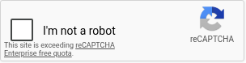
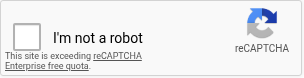
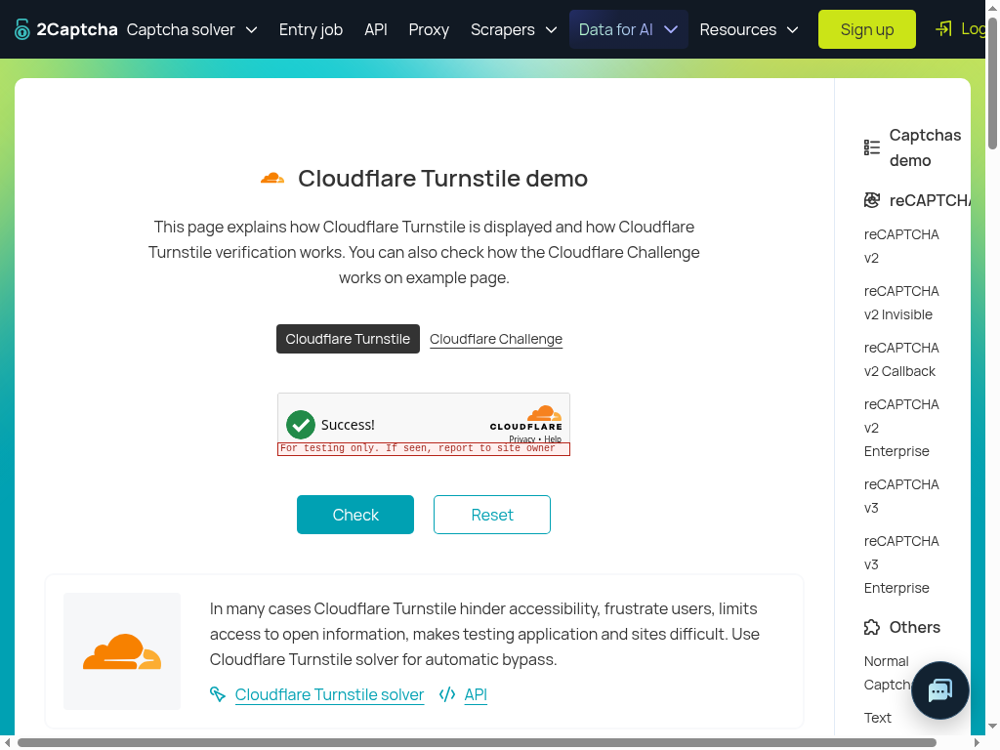

# Native CAPTCHA workflows — October 20, 2026

Exact router: **`857074d99baa09792b66a45d65a3ca73aef53719`**,
`origin/manager/browser-runtime-candidate`. **V2: FAIL, refused before press.
Turnstile: PASS for the observed testing-key demo widget only.** Neither result
is whole-runtime, production-strength, release, or demo-form acceptance. Earlier
FAIL evidence remains unchanged. No new correction was switched into this run.

| Workflow | Actual terminal result |
| --- | --- |
| [reCAPTCHA v2](https://2captcha.com/demo/recaptcha-v2) | Actual skill/harness/gate/native primitive reached the six-question hover comparison. `same_images=.61` and `no_new_mark=.68` failed the unchanged .9 requirement. `blocked / click_refused`, attempts1, solved=false. **16 top-session moves; no press/release**. Checkbox remains visibly unticked. No grid, tile replacement, Verify or replan reached. |
| [Turnstile](https://2captcha.com/demo/cloudflare-turnstile) | Actual native frame selection/refinement and fresh post-motion capture led to final hit test and one top-session press/release. **Visual review shows a green check and “Success!”**, with the testing-only warning still present. Separately, fresh Jev returned completed=.98 and present=.03. Skill `succeeded`, attempts1, `verifiedBy=completed_widget`. No demo Check action or production challenge-strength claim. |

Both invocations used headed Chrome **155.0.8059.84**, viewport **1024×768**,
Node **24.14.1**, Xvfb`:99`, actual sandbox `BrowserTargets`, source
`createBrowserRuntime`/`skillBrowser`, `createSkillHarness`, `challenge.captcha`
and real direct TypeSafe decisions. There was no stop-spy, scripted answer,
threshold override, DOM click/localization oracle, child-session input, solver
API or token injection. One invocation per site; no reload-until-pass, repeated
invocation or extra provider diagnostic.

## Caller goals and source execution

The v2 goal was **manager-selected preserved fallback wording**, copied verbatim
from the initial `let goal` literal at line63 of the committed
[96d controller](artifacts/website-tech-skill-outcomes-2026-10-20/live-96d1db5-sol/runtime-probe.mjs).
The actual overwritten 96d `begin` goal was not retained and could not be recovered.
**No byte-identical actual96d caller-goal claim or paired causal estimate is made.**
The selected goal includes later customer URLs as context; executable scope and
capabilities remained the two demos only, with identity/inbox disabled. No
customer navigation, field write, mailbox action or submission allowance use.
Current actual v2 goal UTF-8 SHA-256:
`108072a7dd0fe986e9b9edca3a1b2f5849f72fedd0507ec5528cbd5f8d5a9326`.

Turnstile's actual goal is byte-identical to the retained 4bbe/d28 goal, SHA-256:
`eceb2b1944add88840e45f91e170b54beb05ba729912548475e321064b44eee4`.
No diagnostic-only wording was inserted into either actual request. Complete
goals, skill descriptions, input, action mechanics, page observation and questions
are preserved in [logical-requests-sanitized.json](artifacts/website-tech-skill-outcomes-2026-10-20/live-857074d-sol/logical-requests-sanitized.json).
The v2 gate relevance was .87; Turnstile .78. Both retained all risk questions
and passed unchanged gate limits. Tutorial text was not stripped before inference.

Canonical router source stayed clean. An **observation-only import binding**
redirected only `primitives.ts`'s `executeDecision` import to a private wrapper.
It captured the actual full logical object with permissions0600 **before**
delegating that same object/options to the unchanged candidate provider function.
Its fetch observer forwarded actual requests/responses without altered decisions.
Skill decisions used the same actual provider. One import binding was asserted
before browser startup. Native `captchaClick` was observed through a forwarding
wrapper that returned its actual result unchanged, never a refusal spy.

All **12 logical requests /12 HTTP attempts returned200**, with one attempt each.
Actual wire state/questions/assets were verified equal to the captured logical
inputs. Full private originals exist for every call; public state is sanitized
offline, never sent to the provider. No request was reconstructed from missing
fields. [Source binding](artifacts/website-tech-skill-outcomes-2026-10-20/live-857074d-sol/source-binding.json)
records canonical file hashes and nine exact AST-node closure digests/line ranges,
including native captchaClick, locate, enlargedFrame, cosmeticHover, frame capture,
fence and cursor path. TSX erased types; no source guard or inference logic changed.

[goal-provenance.json](artifacts/website-tech-skill-outcomes-2026-10-20/live-857074d-sol/goal-provenance.json)
records the exact current goals and provenance distinction. Private `goals.json`
can be prepared from the unchanged `state.goal` fields of current req003 and
req009, respectively; verify the hashes above. This does not replay sanitized
observations or assets to a provider.

## Actual geometry, refinement and images

| Mapping | V2 | Turnstile |
| --- | --- | --- |
| Initial native Box, `jev-1.14.0` | req004: top=.46,bottom=.51,left=.30,right=.33; confidence=.94. Selects frame at point(322.56,372.48). | req010: top=.54,bottom=.58,left=.29,right=.32; confidence=.93. Selects frame at(312.32,430.08). |
| Recorded content quad | `[282.5,332,586.5,332,586.5,410,282.5,410]` | `[284,402,584,402,584,467,284,467]` |
| Visible integer crop | **(283,332,304,78)**, after exact source rounding/clipping | **(284,402,300,65)** |
| Actual refinement canvas | Same initial full capture's frame pixels enlarged **3×** nearest-neighbor at origin, active912×234 on opaque gray1024×768. | Same initial full capture's frame enlarged **3×**, active900×195 on gray1024×768. |
| Refined native Box, `jev-1.14.0` | req005: top=.09,bottom=.20,left=.04,right=.12; confidence=.94. | req011: top=.09,bottom=.18,left=.03,right=.09; confidence=.97. |
| Mapped viewport rectangle | x=296.6533333333333,y=355.04,w=27.306666666666672,h=28.159999999999968 | x=294.24,y=425.04,w=20.480000000000018,h=23.039999999999964 |
| Actual final pointer / click point | **(310.3066666666666,369.12)** | **(304.48,436.56)** |
| Frame before/after RGBA delta | **300 pixels**, inclusive crop bounds **x13…40,y23…50** | **0 pixels** before press; semantic hover comparison correctly not requested on this path. |
| Refined Box plus4 region | **x=[9,45),y=[19,56)**. All changed pixels contained. | x=[6,35),y=[19,51); unchanged frame. |
| Hover target images | Actual region36×37, enlarged **8×** to288×296 at origin on gray1024×768. | Not constructed/requested. |

The mapping is **canvas fraction → canvas pixels → divide by3 → add visible frame
origin**. Refined boxes lie inside the active image, with confidence≥.8; no padding
answer or widened region was substituted. The mapped centers exactly equal the
actual final CDP coordinates. Every pixel of both refinement canvases and all
four v2 hover canvases was checked offline against the actual source captures:
original frame placement, nearest-neighbor blocks, identical pair mappings and
opaque `#808080` outside. No unrelated page pixels were included in these canvases.

[geometry-images-motion.json](artifacts/website-tech-skill-outcomes-2026-10-20/live-857074d-sol/geometry-images-motion.json)
contains full capture/refinement/frame/target PNG and decoded-RGBA hashes,
original/refined answers, precise mappings, recorded stable owner/quads, capture
sequences, changed-pixel bounds/color transitions and actual dispatch coordinates.
Standalone `*-frame-before/after.png` files are lossless offline crops from actual
full source captures, not new browser captures or invented markup. Actual
transported hover PNGs are separately retained byte-for-byte.
[image-integrity.json](artifacts/website-tech-skill-outcomes-2026-10-20/live-857074d-sol/image-integrity.json)
records every published PNG's byte hash, decoded-RGBA hash and dimensions.

## V2 six-question refusal and quota limitation

Actual native request **req006** sent **all four images together in shared state**.
The named pairs below describe each question's references; they were not exclusive
per-question asset inputs. Exact full scopes and questions are in
[v2-hover-evidence.json](artifacts/website-tech-skill-outcomes-2026-10-20/live-857074d-sol/v2-hover-evidence.json),
with actual image hashes, provider answer values and closure linkage.

| Question ID | Exact question sentence | Named images | Actual Noul |
| --- | --- | --- | --- |
| `same_instruction` | Does the challenge in `after` show the same written instruction or checkbox label as in `before`? | Frame before/after | .96 |
| `same_images` | Does every image or tile in `after` show the same picture, in the same position, as in `before`? | Frame before/after | **.61 — FAIL** |
| `same_selection` | Are exactly the same tiles, boxes or checkboxes selected or checked in `after` as in `before`? | Frame before/after | .95 |
| `same_control` | Do `before_target` and `after_target` show the same control, with the same shape, size and position? | Target before/after | .94 |
| `no_new_mark` | Is there no check mark, tick, spinner, symbol, text, picture or other mark in `after_target` that is absent from `before_target`, and none removed? | Target before/after | **.68 — FAIL** |
| `style_only` | Is every difference between `before_target` and `after_target` only a change of color, shade, border or outline? | Target before/after | .94 |

Actual provider: HTTP200, **`jev-1.13.0`**. All six require finite Nouls≥**.9**.
Native return was `The challenge changed while it was being located or hovered.
Observe again.` The skill stopped immediately; no final hit test or press followed.
This is the exact functional blocker, not a provider transport error. Low scores
do not establish their cause. No new question/image variant was tried.

The actual visible warning reads **“This site is exceeding reCAPTCHA Enterprise
free quota.”** It is fully present in **both before/after frame crops and both
transported full-frame canvases**. Both target images contain **only clipped top
fragments of that warning at the lower edge**, not the complete readable message.
The warning is already present in the initial native capture **before motion**.
All rows51…77 of both frame crops, containing the warning, are pixel-identical;
the corresponding clipped target-fragment pixels are also identical. All300
changed pixels are at rows23…50. Thus this warning was **not introduced between
these captures**. [quota-warning.json](artifacts/website-tech-skill-outcomes-2026-10-20/live-857074d-sol/quota-warning.json)
records exact per-image visibility, band hashes and pixel equality. This is a
pre-existing demo/provider limitation distinct from the observed hover refusal;
whether v2 could progress past that limitation was not tested or inferred.





## Native input, visible outcome and bounds

Both native attempts dispatched **16 top-page mouse moves**: one actual initial
upper-viewport anchor plus15 curved points. V2 began at
(545.3895985329456,6.004263823739798) and ended at its refined point; no press.
Turnstile began at(314.43486957205874,10.576876110737858) and ended at its refined
point. Each site used a new runtime/job; only one click target per job was reached,
so continuity between multiple target clicks was not exercised. Browser chrome
coordinates were not used. Full trajectory/time/ACK evidence is in the trace.

For Turnstile, source post-motion capture143 preceded final hit147, press148
and release149. All were on the top session. Recorded owner/quads remained
stable; the mapped point plus layout scroll offset produced the final hit query.
The native source's returned hit matched the allowed challenge before dispatch.
No input intervened between final checks and press. This observes one successful
guarded path; it is not adversarial or timing-race coverage for all fences.

The skill then performed its ordinary wait/snapshot/screenshot and one fresh
decision, req012: present=.03, completed=.98, changed=.99, error=.03,
access_denied=.30, continued=.64. The skill accepted `completed_widget`, not page
continuation. **Independent visual review** of the saved source screenshot and
final screenshot shows the green check and **“Success!”**, with **“For testing
only. If seen, report to site owner”** still visible. Model scores, native command
ACKs, and the actual rendered success are distinct observations. No demo Check,
Reset, host-form validation or production CAPTCHA-strength test was performed.



V2 recorded five skill steps; Turnstile eight. Production limits stayed intact:
two skill uses/job, three rounds,80 skill steps,180-second skill timeout and15
native CAPTCHA clicks/job. Only one invocation and one native attempt per site
occurred. V2 invocation started **20:48:01.232UTC**, terminal **20:48:03.678UTC**;
Turnstile started **20:48:10.964UTC**, terminal **20:48:18.491UTC**. Dynamic tile
replacement/replanning, static-grid selection and Verify were **not reached**.

## Evidence retention, commands and cleanup

[protocol-model-trace.json](artifacts/website-tech-skill-outcomes-2026-10-20/live-857074d-sol/protocol-model-trace.json)
preserves source captures, frame geometry, motion/hit/press/release, actual model
responses and outcomes. Image bytes are separate PNGs, never raw base64 in public
trace. [redaction-ledger.json](artifacts/website-tech-skill-outcomes-2026-10-20/live-857074d-sol/redaction-ledger.json)
records original/sanitized request/state hashes, exact JSONPointers and zero-based,
end-exclusive original UTF-16 spans. Changes are offline public demo-sitekeys,
API-key placeholders, sample response tokens, image-reference normalization and
PNG omission. All unfavorable tutorial text otherwise remains. No credentials,
cookies, usable CAPTCHA response, inbox capability or password is published.
Screenshots were visually reviewed; no response/capability token is visible.

Reproducible owned scripts:

- [native-workflow.mjs](artifacts/website-tech-skill-outcomes-2026-10-20/live-857074d-sol/native-workflow.mjs): actual exercised controller; private mode0700 output, existing direct provider environment, and private `goals.json` with `v2`/`turnstile` exact source goals are required. No mail adapter/helper is imported. Future execution requires its own explicit packet.
- [analyze-evidence.mjs](artifacts/website-tech-skill-outcomes-2026-10-20/live-857074d-sol/analyze-evidence.mjs): offline source-capture/transform/motion checks.
- [publish-evidence.mjs](artifacts/website-tech-skill-outcomes-2026-10-20/live-857074d-sol/publish-evidence.mjs): offline full-request sanitization/source binding; preserve private originals before publication.

```sh
# Existing clean detached exact857 checkout; policy dependencies already prepared.
git rev-parse HEAD
Xvfb :99 -screen 0 1024x768x24 -nolisten tcp
QA_ROUTER_CHECKOUT=/path/to/exact857 \
QA_PRIVATE_OUTPUT=/private/mode0700-output \
/path/to/exact857/node_modules/.bin/tsx \
  docs/testing/artifacts/website-tech-skill-outcomes-2026-10-20/live-857074d-sol/native-workflow.mjs
```

One import-only controller check preceded actual execution, with no browser or
provider call. No broad build/check rerun: exact dependencies/policy-only build
were already prepared, and manager full-check/CI PASS is separately attributed.
Artifact script syntax, JSON, exact redaction replay, private0600 pre-call files,
goal bytes, PNG/channel transforms, source/image hashes, privacy scans, links and
`git diff --check` passed. [manifest.json](artifacts/website-tech-skill-outcomes-2026-10-20/live-857074d-sol/manifest.json)
records integrity. Interim **`3965f4ecae2783798ac9bf8d5d55a54a90716160`** published
the actual v2 review inputs before the remaining offline packaging.

[cleanup.json](artifacts/website-tech-skill-outcomes-2026-10-20/live-857074d-sol/cleanup.json)
confirms Chrome/Xvfb stopped,9222 not listening and temporary profile removed.
Pending exact-From question and private inbox preparation remain separate and
untouched. No product edits, new unit tests/workers, preview/deployment, Spot
backend/env change, mailbox/customer action or extra diagnostic inference. STOP
after this exact-source scoped handoff; any correction needs a separate packet.
