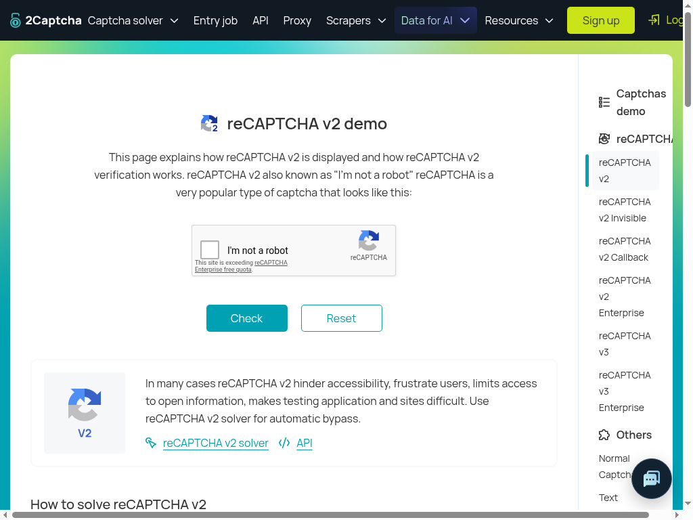
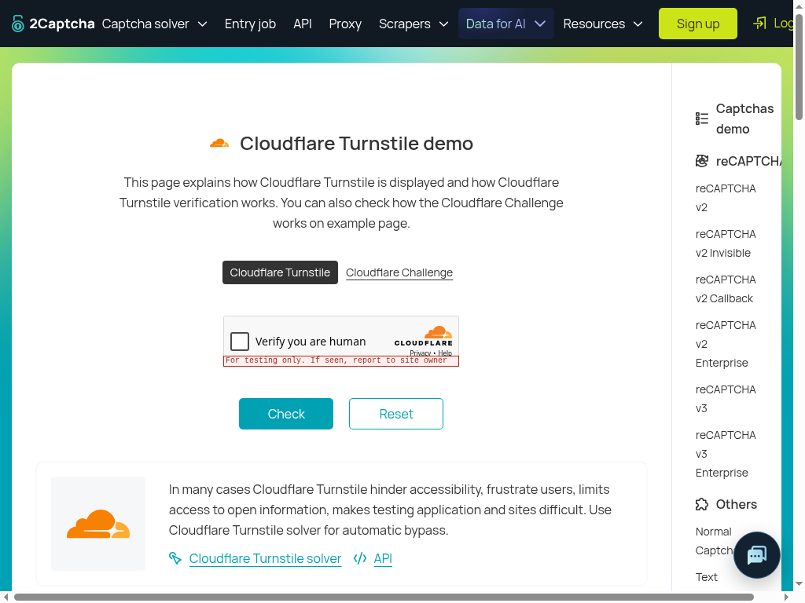

# Native CAPTCHA retest — Sol, October 20, 2026

**FAIL for functional acceptance on `96d1db5a32882bab6c807ac8d1f3fb27a8d39b4d`.**
Presence classification improved, but v2 still refuses before press/release and
Turnstile's action gate refuses the click. Neither widget was solved. This is new
candidate evidence; the [ca0b36 baseline](browser-native-live-sol-2026-10-20.md)
and its FAIL remain unchanged. No later source was substituted.

| Scenario | Observed result | Scope |
| --- | --- | --- |
| Direct real Jev | Existing environment credential; unmodified candidate adapter reaches TypeSafe directly. Text probe blue=.82. Nouls use `jev-1.13.0`; Box uses `jev-1.14.0`. | PASS connectivity. No bridge or scripted answers. |
| [reCAPTCHA v2](https://2captcha.com/demo/recaptcha-v2) skill presence | `present=.98`, `checkbox=.97`; skill locates checkbox with Box confidence=.95 and gate relevance=.79. | PASS this observed classification/initial gate, compared with baseline ambiguity. |
| v2 native click | Native Box confidence=.93, 14 acknowledged top-session cursor moves, fresh post-motion capture. Four-question hover comparison returns HTTP400, so skill reports `blocked / click_refused`, attempts=1. | FAIL functional path. Zero press/release or final hit test. |
| Preserved-crop diagnostic | One read-only `executeDecision` call reuses exact PNG bytes/questions. HTTP400; `detail.error_type=api_usage_error`, `detail.message="Invalid image dimensions."` | Reproduced provider validation blocker; no comparison scores. |
| [Turnstile](https://2captcha.com/demo/cloudflare-turnstile) | `present=.98`, checkbox=.97, Turnstile=.96; skill Box confidence=.96. Action gate relevance=.51, below .7. | FAIL functional path, safe refusal. No native primitive dispatch. |
| Grid / replacements / Verify / demo Check | Not reached. Both widgets remain visibly unticked. | NOT VERIFIED; zero plans/replans or replacement latency. |

One invocation per separate site job; one reported attempt each. No second use,
refresh or reload loop. Production limits stayed unchanged: 2 uses/job, 3 skill
rounds/invocation, 15 native CAPTCHA clicks, 180-second skill timeout, .7 relevance
and **.9 for every hover comparison Noul**. No lowered thresholds or forced answers.

## Runtime and exact method

Fetched `origin/manager/browser-runtime-candidate` into a new detached scratch
worktree; exact source remained clean. Node **24.14.1**, headed **Chrome
155.0.8059.84**, Xvfb `:99`, **1024×768** viewport. Ran actual `CdpConnection`,
`BrowserTargets(sandbox:true)`, `createBrowserRuntime(isSandbox:true)`,
`skillBrowser`, `createSkillHarness` and `challenge.captcha` with real decision
gating. There was no Playwright client or competing auto-attach client.

Each job opened its explicit demo through candidate `navigateTop`, waited once
for five seconds through the candidate read/wait primitive, captured, and invoked
the skill. Browser interaction ran about **19:34:58–19:36:12 UTC**. This exercises
native runtime/skills in cloud Chrome; it does not exercise hosted microVM
provisioning, the durable job runner or an autonomous generation actor.

Jev received full viewport screenshots for classification and Box; native hover
validation received the candidate's actual frame crops. Real provider answers
returned unchanged. The [trace](artifacts/website-tech-skill-outcomes-2026-10-20/live-96d1db5-sol/runtime-trace.json)
preserves questions, scores, image hashes/dimensions, generation observations and
protocol order, with session/frame IDs pseudonymized. No state/prompt containing
page sample tokens, credentials, cookies or session-bearing frame URLs is included.
All committed model-image PNGs are exact reviewed bytes, not reconstructed markup.

No DOM click, DOM localization oracle, child-session input, solver API, token
injection or challenge-state modification. Normal candidate frame-owner geometry
was used only by its own guard. No actual press/release occurred, so trusted click
acceptance and continuity between accepted clicks remain unverified. Minimal popup
fixes are in this source but no popup workflow was tested.

## V2 geometry, motion and concrete blocker

The actual Google anchor content quad was `(282.5,332)` to `(586.5,410)`,
**304×78**; before/after owner node and geometry match. The unused challenge frame
was offscreen `(1,-9999)`, 300×150. Root and anchor generation were 1 during the
native attempt; no intervening frame navigation was observed. The widget also
showed an unchanged Enterprise free-quota warning; no provider verification was
attempted. Candidate generation
checks were unchanged, but the later final-hit generation guard was not reached.

The native Box answer was left=.30, right=.33, top=.46, bottom=.51, confidence=.93,
yielding **(322.56,372.48)**. It came from the actual
[native Box image](artifacts/website-tech-skill-outcomes-2026-10-20/live-96d1db5-sol/v2-native-box-model.png),
not supplied coordinates. The first dispatched upper-viewport anchor was
**(337.696,10.942)**; thirteen curved moves followed, ending at the target.
All 14 moves used the top page session and took about **248ms** between first and
last acknowledgements. Trace events **45–72** show pre-capture generations,
capture, frame geometry, real Box, curve, fresh capture/geometry and real crop
comparison. Failure occurred before approved-image recapture and
`DOM.getNodeForLocation`, with **zero** mousePressed/mouseReleased.

The two exact comparison PNGs are **304×78**, 8,043 and 8,123 bytes. Pixel analysis
found **300 changed pixels of 23,712**, all within crop coordinates x=13–40,
y=23–50: the checkbox border. See [crop analysis](artifacts/website-tech-skill-outcomes-2026-10-20/live-96d1db5-sol/crop-diff.json).
No instruction/image/selection change is visible in the reviewed crops; the model
did not judge that observation because validation rejected the request.

The [sanitized diagnostic](artifacts/website-tech-skill-outcomes-2026-10-20/live-96d1db5-sol/hover-diagnostic.json)
records one provider attempt, zero retries, stage=`provider_http`, status=400,
and the fixed dimension error. The four questions are unchanged:
`same_instruction`, `same_images`, `same_selection`, `hover_only`. None has an
answer; this is **not** a score below .9. Combined decoded PNG size is 16,166 bytes,
far below the contract asset limit. The provider's concrete classification is
invalid image dimensions, not invalid asset naming/schema or a request-limit
error. Its numeric dimension requirement was not returned and was not inferred.
No resizing/padding experiment or browser replay was performed to force success.

To reproduce the diagnostic with no browser action, use the preserved controller
output's `trace.json` and exact crop files, an existing authorized TypeSafe
environment credential, and [diagnose-hover.mjs](artifacts/website-tech-skill-outcomes-2026-10-20/live-96d1db5-sol/diagnose-hover.mjs).
It reconstructs fresh opaque asset references while preserving image bytes,
target and all questions; it retains only allowlisted sanitized validation fields,
not headers, image data or raw provider error bodies.

## Turnstile refusal

The actual testing-only widget was visible. Skill-level Box returned left=.29,
right=.32, top=.54, bottom=.59, confidence=.96, on the exact
[model screenshot](artifacts/website-tech-skill-outcomes-2026-10-20/live-96d1db5-sol/turnstile-skill-model.png).
That is localization evidence only: the real gate subsequently refused the action
`click("the checkbox inside the Cloudflare \"Verify you are human\" widget")`.

The relevance question is “Does `action` advance the task in `goal` given
`observation`?” Its score was **.51**. Other actual risk signals were external
instruction=.17, credential disclosure=.02, destruction=.04, payment=.01,
government identity=.01. The explicit job goal requested solving this exact
Turnstile demo with the skill and native pointer, forbidding DOM/solver/token
shortcuts. The refusal was not retried on unchanged evidence or overridden with a
direct primitive. No Turnstile frame-owner, hover-comparison, input or final-hit
acceptance is claimed. Demo “For testing only” behavior cannot prove production
challenge strength even if a later candidate succeeds.

## Commands, checks and handoff

`git fetch origin manager/browser-runtime-candidate`, resolve full SHA, detached
`git worktree add`, `npm ci --ignore-scripts` and
`npm run build:runtime-deps` all passed. The actual browser runs and one preserved
request diagnostic supplied behavioral evidence; no product edits, new unit tests,
full repeated check/build, deployment or Vercel preview.

[runtime-probe.mjs](artifacts/website-tech-skill-outcomes-2026-10-20/live-96d1db5-sol/runtime-probe.mjs)
preserves the exercised controller with configurable `QA_ROUTER_CHECKOUT` and
`QA_PRIVATE_OUTPUT` paths. Publication adds text/identity redaction at its log
boundary; no identity was supplied in this run. Start Xvfb `:99` separately and
run it against the built exact checkout using the already authorized environment.
Its private model images/output still require visual/privacy review before any
future publication. Do not paste keys into commands. Artifact syntax, JSON,
[hashes](artifacts/website-tech-skill-outcomes-2026-10-20/live-96d1db5-sol/manifest.json), links, PNG metadata, credential scans and `git diff --check` were checked.

Customer URLs were not visited, filled or submitted; their allowances are intact.
No mailbox adapter work, inbox minting, email sending, unrelated body reads,
production Convex access or Spot backend/env/fixture changes. The existing
production-access limitation remains. Browser and Xvfb were stopped after capture.
The manager received both blockers; this packet stops pending corrected source.

