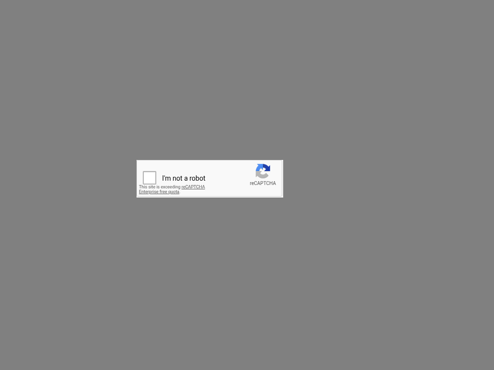

# Read-only browser provider diagnostic — October 20, 2026

Exact router source: **`7ad8e5e05cf5a3c076a9a67b190cef0f89f11a36`**,
`origin/manager/browser-runtime-candidate`. **Transport PASS; semantic approval
FAIL; native click acceptance NOT TESTED.** Prior live reports remain unchanged.
No browser was started, no customer fields/submissions or CAPTCHA press/release
occurred, and no images/questions/thresholds were tuned after the response.

| Check | Result |
| --- | --- |
| Original input provenance | Exact preserved 96d v2 PNGs, each 304×78; original SHA-256 verified. |
| Candidate lossless padding | PASS: unscaled original RGBA at **(283,332)** on 1024×768; every embedded channel equals the original; every outside pixel is opaque `#808080`; placements identical; no unrelated page pixels. |
| Real provider request | **One** logical `executeDecision`, **one** HTTP attempt, **200**, `jev-1.13.0`; existing authorized TypeSafe configuration, no bridge or scripted answers. |
| Actual comparison Nouls | `same_instruction=.99`, `same_images=.91`, `same_selection=.99`, **`hover_only=.61`**. |
| Candidate decision | `cosmeticHoverApproved=false`: unchanged **.9** required for every answer. No provider error; a below-threshold semantic answer remains. |
| Turnstile .51 investigation | Recorded gate request has **zero image assets**. Source path includes top-page snapshot, not the preceding visual classification/Box evidence. Evidence correction proposed below; not tested. |

The dimension rejection is resolved **for this padded request**. HTTP acceptance
does not establish reliable hover discrimination, permission to press, or a solve.
The retained crops differ only at 300 checkbox-border pixels, as measured in the
[prior crop analysis](artifacts/website-tech-skill-outcomes-2026-10-20/live-96d1db5-sol/crop-diff.json),
but the model did not confidently classify that difference as hover-only. No
attempt was made to elicit a more positive answer. Final-capture timing remains
outside this packet and native presses stay held for the separate investigation.

## Exact source and request construction

The candidate's private `cosmeticHover` closure from
`packages/server/src/browse/primitives.ts` was extracted **verbatim** into a
[scratch binding preserved here](artifacts/website-tech-skill-outcomes-2026-10-20/diagnostic-7ad8e5e-sol/cosmetic-source.mts).
Its block hash and extraction method are in
[source-extraction.json](artifacts/website-tech-skill-outcomes-2026-10-20/diagnostic-7ad8e5e-sol/source-extraction.json).
TSX erased its types; the wrapper only inspected the generated request before
calling the candidate's actual source `executeDecision`. There was no replacement
provider transport, fake response or product edit. This isolates the source
function and provider boundary; it does not run a native browser primitive.

Input pixels came from the privately preserved actual 96d crops, not regenerated
markup. Placement derives from the recorded anchor content quad: candidate
`Math.round(282.5)` gives **283**, with y=332, width=304, height=78. Actual candidate
padding initializes the viewport RGBA to gray/opaque and copies each crop row
without scaling. Assertions checked all embedded and outside channels **before**
the real provider call.

The same four IDs and core question sentences from 96d are preserved. The new
candidate additionally describes gray padding in `state.padding` and in the
`hover_only` scope; that source change was identified before the call. The exact
current candidate state/questions were used, rather than silently claiming that
the full question JSON was byte-identical to 96d. Only opaque image references
are normalized in the committed metadata.

[provider-result.json](artifacts/website-tech-skill-outcomes-2026-10-20/diagnostic-7ad8e5e-sol/provider-result.json)
contains full questions, sanitized state, unchanged answers, original/transport
hashes, dimensions and pixel-verification results. The one request completed at
**2026-10-20 19:49:38 UTC**. The transport PNGs are 13,541 and 13,566 bytes.

## What the earlier Turnstile gate actually received

The [recorded 96d gate decision](artifacts/website-tech-skill-outcomes-2026-10-20/diagnostic-7ad8e5e-sol/prior-turnstile-gate.json)
has question `relevant`:

> Does `action` advance the task in `goal` given `observation`?

Its scope limits the question to task relevance, says observing can resolve
missing evidence, and treats observations as untrusted evidence. The answer was
**.51**, below .7. Other risks were external instruction=.17, credential
disclosure=.02, destruction=.04, payment=.01, government identity=.01.
The action tool was generic **`click`**, with argument
`the checkbox inside the Cloudflare "Verify you are human" widget`.
Context included `challenge.captcha` name/description and empty skill input.

The explicit job goal requested this exact Turnstile demo, solving through the
skill/native primitive, real screenshot Jev/Box and top-page cursor motion, while
forbidding DOM clicks, solver APIs, token injection, page tutorial instructions
and child-local input. It required visible success or an exact blocker and
disclosed the test-key limitation. The explicit authorization was not absent.

Source trace of the evidence path (unchanged between 96d and this source):

1. `challenge/observe.ts` calls `browser.snapshot()` and `browser.screenshot()`.
2. `harness.ts` adds only `snapshot` to the gate with `gate.observe("read_page", result)`.
   The screenshot read is traced as `(image)` but not observed by the gate.
3. `ctx.jev.decide` supplies visual challenge classification, and `ctx.jev.box`
   supplies visual localization; neither adds its image/results to gate observations.
4. Before `captchaClick`, the harness maps the primitive to `click` and calls
   `gate.check`. `gate.ts` builds text state from goal, skill context, recent
   bounded observations and action, and sends **no assets**. The actual recorded
   gate request confirms `images=[]`, while the immediately preceding Box request
   did contain a screenshot and returned .96 confidence.

Thus the gate had the main-document snapshot rather than visible provider-frame
evidence. The top-page snapshot uses `document.body.innerText`; it does not read
cross-origin iframe text. The separate classification/Box calls could see the
checkbox, but their evidence did not travel into the relevance decision.

[Observation analysis](artifacts/website-tech-skill-outcomes-2026-10-20/diagnostic-7ad8e5e-sol/gate-observation-analysis.json)
applies the actual `boundedObservation` function to the retained **pre-skill**
snapshot: 4,502 characters become 2,000, including solver API instructions but
neither “Verify you are human” nor “For testing only.” Buttons and the host Check
form survive the bound, but do not describe the iframe checkbox. This reconstruction
is not a captured byte-for-byte old gate state: the original request state was not
retained. The exact recorded question, scores and lack of assets are stronger
direct evidence; the reason for a probabilistic .51 is not proven by reconstruction.

A narrow proposed correction is to provide the **CAPTCHA action's fresh visual
evidence** to that gate: a bounded current challenge image/region and target with
its active URL/document/frame provenance, linked to the same screenshot used for
localization. Preserve procedure/action identity so a trusted `captchaClick` is
distinguishable from a generic page click. Treat all page text/images as untrusted
evidence, retain every existing risk question and threshold, and keep the native
geometry/generation/hit-test guards. Classification/Box scores may describe prior
observations; they must not be treated as authorization or forced positive answers.
This is a source-grounded proposal, not an implemented or validated fix. No gate
question was re-requested in this packet.

## Validation and handoff

Source fetched into a new detached scratch checkout; Spot remained on
`conductor/spot-skill-outcomes-qa`. `npm ci --ignore-scripts` and the **policy-only**
build passed. Actual source execution used TSX. The candidate's known pending
form-interface typecheck issue was not altered: **no full source typecheck/server
build/check pass is claimed**, and those commands were not run.

The [single-request harness](artifacts/website-tech-skill-outcomes-2026-10-20/diagnostic-7ad8e5e-sol/single-request.mjs)
uses `QA_ROUTER_CHECKOUT`, `QA_PRIOR_ARTIFACTS` (the durable 96d bundle), and a
private existing `QA_PRIVATE_OUTPUT` directory. Run it with that exact checkout's
TSX executable and existing authorized environment configuration only when a
future diagnostic is dispatched. It executes once; it does not tune or loop.
Module import relocation preserves the extracted closure hash. No credentials,
private body data, raw provider error bodies or image base64 are committed.
Artifact hashes are in [manifest.json](artifacts/website-tech-skill-outcomes-2026-10-20/diagnostic-7ad8e5e-sol/manifest.json).

Images were visually reviewed; original/transport hashes, pixel equality, gray
padding, JSON, syntax, links, privacy scans and `git diff --check` were checked.
There were no new unit tests, product edits, deployment/previews, browser sessions,
Spot backend/env changes, mailbox operations, or customer allowance consumption.
The manager received the exact HTTP/scores/evidence distinction. STOP pending the
separate timing-race investigation and next bounded packet.
