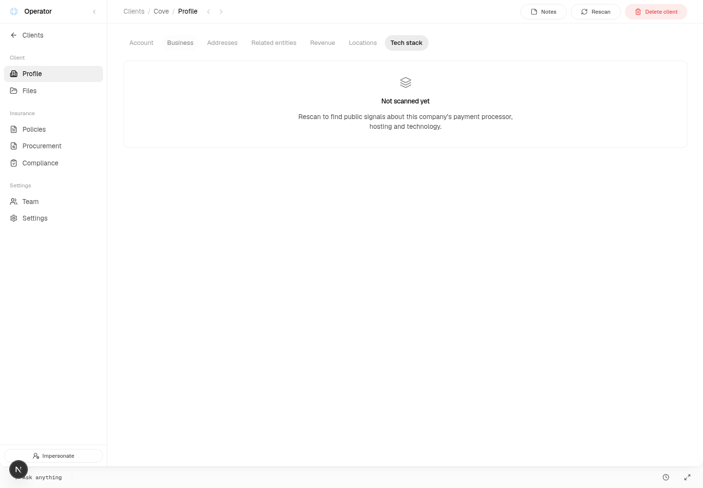

# Website tech no-profile consumer addendum — PASS

Fresh scoped acceptance on exact Spot **`cc8bb050c20f6cb45798da7c6eb986d4b0b884af`**, 2026-10-20 UTC, Node24.14.1, headed cloud Chrome155.0.8059.84 at1440×1000. This closes the null-before-scan/tool and not-scanned UI gap disclosed in the [accepted final consumer report](website-tech-final-consumer-sol-2026-10-20.md). Existing reports and their outcomes remain unchanged.

| Scenario | Actual result |
| --- | --- |
| Ordinary website with no profile | PASS — fresh ordinary seed provides client Cove, `https://cove.dev`; actual native table query found zero websiteTechProfiles and zero routerJobs before auth/UI. |
| Authorized `get_organization` before scan | PASS — actual registered internal executor, ordinary operator actor, channel `mcp`; own `websiteTech` property equals **null**. No scan or website write preceded this assertion. |
| Normal authentication and operator query | PASS — normal operator login with fresh exact-recipient capture OTP; authenticated actual `websiteTech.getForOperator` returns website plus `profile:null`. |
| Actual Profile → Tech stack | PASS — “**Not scanned yet**” and exact current-source description; no Browser research, Site visit, skill outcome rows or scanning/failure/findings presentation. Screenshot visually reviewed. |
| No scan side effect; cleanup | PASS — profiles/jobs remain0, website unchanged, router URL/secret absent; auth snapshot removed, Chrome/Next/Convex/Xvfb closed, ports8080/8083/8084/9222 closed. |

Expected presentation was established from exact-source `website-tech-section.tsx:303`: “Rescan to find public signals about this company’s payment processor, hosting and technology.” `convex/websiteTech.ts:75` returns null when the hostname index finds no profile; `convex/operatorAgent.ts:1761` projects that actual reader into the organization tool. [Source binding](artifacts/website-tech-skill-outcomes-2026-10-20/empty-consumer-cc8bb050-sol/source-binding.json) verifies13 current files against exact Git blobs, including route/component, storage, executor, registry and seed.

The retained accepted-run client already had a profile. This run used a new detached checkout and fresh native-local database, copying only private existing local config and loopback selectors, with codegen/typecheck disabled to preserve source. Minimal child environments excluded ambient deploy/provider keys; every later env/seed/executor operation checked local mode and explicit8083/8084. Both router values started and stayed absent, so no credential removal/restoration was needed. Original backend and pending private inbox were untouched. No product endpoints or code were added.

The initial bootstrap seed CLI returned exit1 without retained public error details. The controller had already completed local environment setup. Actual table read then proved organizations0; one guarded invocation of existing `seed:seed` completed setup and confirmed profiles0. This is a setup failure, not a consumer failure; its cause is not established. Two setup file-path mistakes produced no writes/calls before being corrected. No fixture clearing, repeated fixture search, scan or website mutation was used.

Commands/results: `local-lane.mjs … convex/bootstrap/web` established the isolated lane (initial bootstrap exit1 as above); `finish-seed.mjs` PASS after zero-organization guard; `empty-qa.mjs` PASS; `cleanup.mjs` PASS; `publish.mjs …` PASS for whitelist,13 source blobs, clean candidate and closed ports. Browser protocol records real `websiteTech:getForOperator` subscription and only structural message counts/names; the ordinary bootstrapViewer mutation is recorded separately from zero scan/website mutations. [Actual assertions](artifacts/website-tech-skill-outcomes-2026-10-20/empty-consumer-cc8bb050-sol/results.json), [protocol](artifacts/website-tech-skill-outcomes-2026-10-20/empty-consumer-cc8bb050-sol/protocol.json), [cleanup](artifacts/website-tech-skill-outcomes-2026-10-20/empty-consumer-cc8bb050-sol/cleanup.json), [validation](artifacts/website-tech-skill-outcomes-2026-10-20/empty-consumer-cc8bb050-sol/validation.json), and [replay instructions](artifacts/website-tech-skill-outcomes-2026-10-20/empty-consumer-cc8bb050-sol/README.md) are durable.

No whole-union rerun, new unit tests, types/build rerun, provider inference, production/customer/external-mail/inbox/native CAPTCHA actions, preview or deployment occurred. Rescan was intentionally not initiated. This proves the local consumer empty-state/read only, not HTTP/OAuth MCP, provider/router/native acceptance or whole-shell acceptance. The prior390px shell416px overflow remains a separately disclosed issue. No new consumer defect was observed in this addendum.

Delivery branch: `conductor/spot-skill-outcomes-qa`. Only this new report and its new artifact directory are included in the addendum commit.
