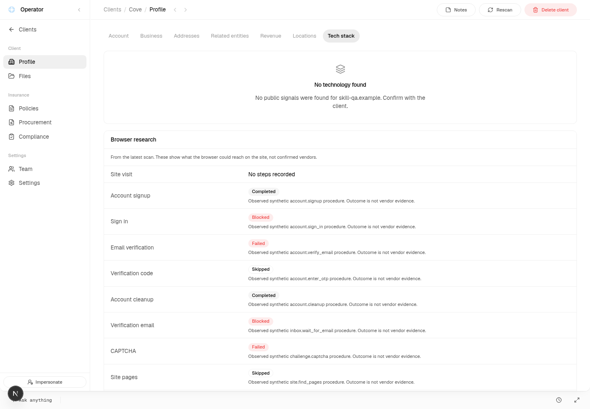
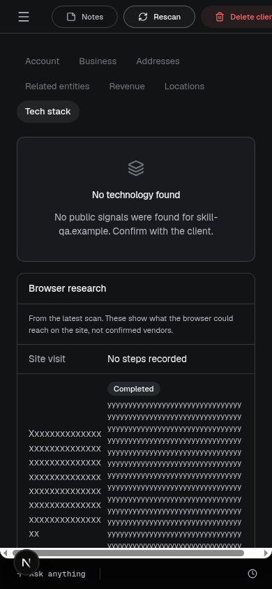

# Exact cc8bb050 final consumer QA — Sol

**Scoped consumer checks PASS; existing mobile shell overflow remains FAIL/open.** All15 app groups,8 boundary groups,5 access groups,6 request-construction groups and the keyboard/reload/live-card follow-up were rerun on exact Spot **`cc8bb050c20f6cb45798da7c6eb986d4b0b884af`**, in an isolated detached checkout. None of this UI evidence is carried from101b or2c1b. Full mobile-shell acceptance is not granted. No router/provider/native CAPTCHA or release acceptance is implied, and earlier router/model failures remain immutable.

Router source/contract revision: **`af229cc363c6a602f2964bfda2c4961dd0cf6e5f`**. Pinned OpenAPI SHA256: **`39aed5a439bb5c9ed636ac30929fcb9e3367b4239295f608de375c7134c68393`**. Actual bytes from that router Git blob equal Spot's checked-in snapshot and clean-source provenance. Required checker passes **22 fixtures / 11 operations**.

Node `v24.14.1`, 2026-10-20 UTC. Actual local Next8080, native-local Convex8083/8084, visible cloud Chrome on Xvfb `:99`. Normal seeded operator browser OTP sign-in used a fresh local capture; no auth bypass or invented page/component harness. Actual route: `/operator/clients/<synthetic-Cove-id>/wiki`, Tech stack tab. Source and dependency hashes are in [source-binding.json](artifacts/website-tech-skill-outcomes-2026-10-20/final-consumer-cc8bb050-sol/source-binding.json); contract linkage is in [contract-provenance.json](artifacts/website-tech-skill-outcomes-2026-10-20/final-consumer-cc8bb050-sol/contract-provenance.json).

## Local isolation and fixture scope

The retained original workspace backend stayed stopped and untouched. A fresh database in the detached checkout reused only the existing private native-local config and three local selector/loopback entries; it did not clone hosted settings/data. Package/lock bytes match, so dependencies were hardlinked. The local controller excludes ambient cloud/deploy keys and provider credentials from child environments. Initial empty-backend bootstrap used the repo's local key generator and ordinary `seed:seed`, `SPOT_ENV=local`, `EMAIL_DELIVERY_MODE=capture`. Every later env/fixture write checks the explicit loopback/local guards. Both router URL/secret variables were absent initially and remained absent; no credential removal/restoration or hosted env mutation was needed. [Bootstrap and final presence-only receipts](artifacts/website-tech-skill-outcomes-2026-10-20/final-consumer-cc8bb050-sol/results/isolation-cleanup-receipt.json).

Populated outcome states were staged through the existing authenticated `operator.updateClientSettings`/`websiteTech.rescanForOperator` and guarded internal `websiteTech.claim`/`websiteTech.finish` paths on the synthetic Cove fixture, temporarily using `https://skill-qa.example`. These are real persisted records and real subscription-driven app UI. The synthetic skill outcomes **do not mean those router procedures ran**. Their ten-name display fixture includes cleanup solely to test the complete vocabulary; the actual research request excludes cleanup. Real navbar Rescan runs the actual local action to its genuine credential-free terminal state; no fabricated backend response stands in for that transition. No AI provider call/shared router job was made.

## Current rendered UI/storage/executor results

All rows below are current cc8bb050 observations. [Full15-group receipt](artifacts/website-tech-skill-outcomes-2026-10-20/final-consumer-cc8bb050-sol/results/app-results.json).

| Scenario | Result and observed evidence |
| --- | --- |
| Ten known names plus unknowns | PASS: Account signup, Sign in, Email verification, Verification code, Account cleanup, Verification email, CAPTCHA, Site pages, Page overlays, Payment page; readable `custom.new_workflow`, `constructor`, `toString` fallbacks. No inherited-name map resolution. |
| Four statuses | PASS: `succeeded/blocked/failed/skipped` show Completed/Blocked/Failed/Skipped. |
| Zero steps | PASS: No steps recorded; no “Did not run” inference. |
| No findings | PASS: No technology found with retained Browser research/procedure outcomes. |
| Failed scan | PASS: Could not scan skill-qa.example with retained synthetic outcomes. |
| Legacy no browse | PASS: explicit no-visit message; no invented Site visit row. |
| Browse without skills | PASS: Site visit remains, distinct no-outcomes message. |
| Finished/partial and grammar | PASS: Finished/Stopped before finishing;1 step/2 steps. |
| Maximum count | PASS:40 persisted skills plus one Site visit row rendered in actual app. |
| Narrow document metric | PASS only for document `scrollWidth<=390`; this does **not** negate inner-shell failure below. |
| Mobile/dark presentation | Actual mobile rows/screenshots inspected. Existing helper sets the dark class; this is not normal settings-toggle or whole-theme acceptance. |
| `get_organization` projection | PASS: actual registered local executor, channel `mcp`, returns saved redacted array under `websiteTech.browse.skills`. |
| `research_client_tech_stack` projection | PASS: same authorized executor queues and returns prior saved array under `current.browse.skills`. |
| Rescan subscription lifecycle | PASS: actual navbar click shows Scanning → terminal failed without reload; Browser research hides during scan and returns afterward. |
|100-char name/500-char summary | PASS: at390px, unbroken text right edges145.6875/346.25 stay inside card edge366; no horizontal skill-text clipping. |

[Follow-up](artifacts/website-tech-skill-outcomes-2026-10-20/final-consumer-cc8bb050-sol/results/app-followup-results.json) additionally passes keyboard Enter on Tech stack, reload retaining stored outcomes, and the live scan/card lifecycle. [Rescan states](artifacts/website-tech-skill-outcomes-2026-10-20/final-consumer-cc8bb050-sol/results/app-rescan-transitions.json) are `scanning,failed`; this observes the combined pending/running presentation, not separate timing measurements of both backend phases. [Structural protocol](artifacts/website-tech-skill-outcomes-2026-10-20/final-consumer-cc8bb050-sol/results/protocol-results.json) records actual query-set/authentication message types, the rescan Mutation/MutationResponse and subscription Transitions, never payloads/headers/arguments. It is corroborating structural evidence, not a raw protocol dump.

**SHELL-01 remains FAIL/open:** in a390px viewport the actual shell wrapper is390px wide with416px scroll content, and navbar actions clip; the horizontal inner scrollbar is visible. Skill-row emergency wrapping works independently. Do not label document-only width checks as whole-shell acceptance or treat this as waived/fixed. [Measured wrapper](artifacts/website-tech-skill-outcomes-2026-10-20/final-consumer-cc8bb050-sol/results/app-inner-overflow.json), [skill geometry](artifacts/website-tech-skill-outcomes-2026-10-20/final-consumer-cc8bb050-sol/results/overflow-geometry.json). No shell/product change was made; manager owns triage.

## Current boundary and access checks

[Eight boundary groups](artifacts/website-tech-skill-outcomes-2026-10-20/final-consumer-cc8bb050-sol/results/boundary-results.json) execute the actual imported current `clRouterBrowse` against local in-memory responses, plus the actual extracted/transpiled `skillOutcomes` function. This is client/projection execution, not a provider-backed action:

- Old response without skills accepted; all four statuses and zero steps accepted.
-40 accepted/41 rejected; name101/version41/summary501 rejected; bad status/type, fractional/negative steps and non-array skills rejected.
- Extra keys dropped by actual projection; projection caps40 and preserves absent skills.
- Random synthetic password, inbox capability, verification-URL token, research address and other address redacted. The projected safe output is then actually stored/read back in the app/tool workflows; no raw generated secret was persisted in artifacts. [Safe fixture](artifacts/website-tech-skill-outcomes-2026-10-20/final-consumer-cc8bb050-sol/results/projected-fixture.json).

[Five access groups](artifacts/website-tech-skill-outcomes-2026-10-20/final-consumer-cc8bb050-sol/results/access-results.json) pass: anonymous query denied; normally OTP-signed client query denied; client actor rejected by actual registered operator executor; authorized operator read succeeds with current stored profile; actual imported tenant catalog and dispatcher exclude both tools even with write scope. The fourth final group checks authorized current-profile access, **not a fresh pre-scan-null result**. The initial null read occurred before a wrapper parse error; it is not promoted to a completed final group. The not-scanned empty-profile UI was not separately replayed. No local OAuth/HTTP MCP integration ran: executor projection is actual runtime evidence, end-to-end HTTP MCP remains NOT RUN.

## Current request construction, strict schema and pin

[Six request groups/captures](artifacts/website-tech-skill-outcomes-2026-10-20/final-consumer-cc8bb050-sol/results/request-results.json) pass on the actual cc8bb050 `browseCompanySite`, goal/findings schema and actual `clRouterBrowse` serializer. TypeScript extraction supplies in-memory identity/durable-options seams; captures are validated by strict Ajv against the exact pinned BrowseRequest. This is not the complete Convex action, router runtime or remote-provider transport.

| Case | Result |
| --- | --- |
| Identity plus inbox | PASS: valid actual serialized body, signup/inbox included. |
| Identity without inbox | PASS: valid signup without inbox. |
| Identity creation rejects | PASS: actual `settle` omits signup; request remains valid. |
| No config/old response | PASS: absent config remains absent; old response omits skills compatibly. |
| Explicit empty skills | PASS: serialized `[]` remains valid. |
| Vocabulary and selection | PASS: ten contract names, exact explicit nine requested; no cleanup. |

Nine names in order: `site.find_pages`, `page.dismiss_overlays`, `account.signup`, `account.sign_in`, `inbox.wait_for_email`, `account.verify_email`, `account.enter_otp`, `challenge.captcha`, `checkout.observe_payment`. Request root contains only `tenantId,input,config,executionBudgetMs`; tenantId is actually injected; maxSteps30 stays under input; root budget360000. TraceId/channel/taskKind go to durable options (`website_tech_browse`), not body/input/config. Research goal explicitly requests observed-state CAPTCHA continuation, honest blockers, no payment data, no account deletion, and does not equate signup submission with account creation. Full signup/capability/password values are never saved in request receipts.

Exact-pin router **source-only** review: [browse/index.ts:236–245](https://github.com/claritylabs-inc/cl-router/blob/af229cc363c6a602f2964bfda2c4961dd0cf6e5f/packages/server/src/browse/index.ts#L236) derives identity/inbox/Jev capabilities separately, and [skills/registry.ts:22–30](https://github.com/claritylabs-inc/cl-router/blob/af229cc363c6a602f2964bfda2c4961dd0cf6e5f/packages/server/src/skills/registry.ts#L22) intersects names with every required capability. Valid missing-identity Spot serialization therefore does not promise account/email procedures will be offered. Omitted-config compatibility does not promise cleanup exclusion: router defaults include all ten names, while Spot explicitly sends nine. No runtime capability-filter/provider success claim is made.

## Checks, setup interruptions and cleanup

[Commands/results](artifacts/website-tech-skill-outcomes-2026-10-20/final-consumer-cc8bb050-sol/validation.json): contract22/11, root `tsc --noEmit`, Convex `tsc --noEmit -p convex/tsconfig.json`, and focused ESLint all pass. Types ran once each. The correct focused lint command targets the actual component path and websiteTech/client/contract files. Initial incorrect-path lint matched no files; it is recorded as setup error, not a product lint failure. No full root build was rerun; manager supplied CIgreen710d381a, not an independent build claim here. No unit tests were added/run.

[Initial observations](artifacts/website-tech-skill-outcomes-2026-10-20/final-consumer-cc8bb050-sol/initial-setup-observations.json) and [adaptation hashes](artifacts/website-tech-skill-outcomes-2026-10-20/final-consumer-cc8bb050-sol/replay-adaptations.json) preserve the setup issues. Convex initially regenerated an unrelated API type import; the file was restored to exact candidate and codegen disabled before acceptance/types. A missing QA_CHECKOUT invocation failed before auth. An access helper duplicate JSON.parse was corrected to match its guarded helper return type; an immediate retry then hit the genuine24-second OTP rate limit. Subsequent access replay passed after independent work.

Two actual app attempts were interrupted by fixture setup: [first13 passed groups](artifacts/website-tech-skill-outcomes-2026-10-20/final-consumer-cc8bb050-sol/results/app-results-initial.json), [second5 passed groups](artifacts/website-tech-skill-outcomes-2026-10-20/final-consumer-cc8bb050-sol/results/app-results-second-interrupted.json). Neither partial run is presented as full acceptance. [Bounded diagnostic](artifacts/website-tech-skill-outcomes-2026-10-20/final-consumer-cc8bb050-sol/results/stage-diagnostic.json) shows actual scheduled action won `claim` and reached failed before fixture finish twice; third attempt won and stored the exact summary. Source schedules at delay0. The replay helper's **setup-only** bound became20 instead of5, preserving guards, mutations and result verification. Guard reads now run in parallel; cleanup reads paginate with a5000-row bound. This is no product fix, inference retry, retuned assertion or synthetic substitute for Rescan. Final full15-group replay and follow-up passed. No meaningful new consumer defect was hidden by these adaptations.

Cleanup restored the original synthetic website via the authorized writer and waited for real local research to settle. Zero router jobs/shared job IDs exist; zero prepared jobs required cancellation. Both local router variables are still absent, their original fresh-backend state. [Fixture cleanup](artifacts/website-tech-skill-outcomes-2026-10-20/final-consumer-cc8bb050-sol/results/cleanup-results.json), [isolation receipt](artifacts/website-tech-skill-outcomes-2026-10-20/final-consumer-cc8bb050-sol/results/isolation-cleanup-receipt.json), [process cleanup](artifacts/website-tech-skill-outcomes-2026-10-20/final-consumer-cc8bb050-sol/results/process-cleanup.json): private auth/original snapshots removed; owned Next/Convex/Chrome/Xvfb stopped;8080/8083/8084/9222 closed; candidate tracked tree clean. Retained original backend and private inbox/pending From question remain untouched.

Durable [replay/setup guide](artifacts/website-tech-skill-outcomes-2026-10-20/final-consumer-cc8bb050-sol/README.md) documents exact candidate guards/import changes, normal local bootstrap/auth, replay order, setup-only retries and restoration. [Publisher](artifacts/website-tech-skill-outcomes-2026-10-20/final-consumer-cc8bb050-sol/publish.mjs) is offline whitelist-only; [manifest](artifacts/website-tech-skill-outcomes-2026-10-20/final-consumer-cc8bb050-sol/manifest.json) binds source/receipts/screenshots. Public protocol normalizes a public analytics project identifier in one path; [sanitization receipt](artifacts/website-tech-skill-outcomes-2026-10-20/final-consumer-cc8bb050-sol/publication-sanitization.json) binds its original hash/span. No raw logs, auth frames, credentials, private capabilities or inbox bodies are published. Syntax/hash/link/privacy and diff checks pass. Only the owned report/artifact directory is committed. No deployment, production/shared mutation, native CAPTCHA/model diagnostic, automatic next stage or release claim. STOP.
